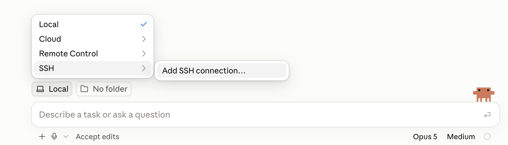
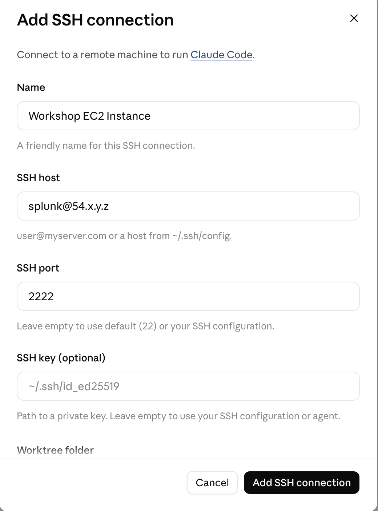

# Claude Setup

Use the following steps to connect Claude to the EC2 Instance provided by the workshop facilitator:

* Open Claude Desktop
* Click on the `Code` tab
* Click on the `Local` button
* Choose `SSH` -> `Add SSH connection...`

* Add the SSH connection details using the information from Splunk Show

* Click `Test connection` and enter your SSH password when prompted
* Click on `Select Folder` and open the `/home/splunk/customer-challenge` folder
* Click `Trust Workspace` when prompted

Now, any commands you enter into Claude will be executed on the EC2 instance. 