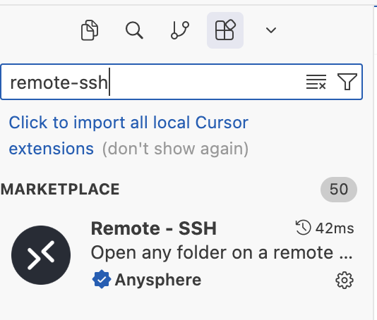
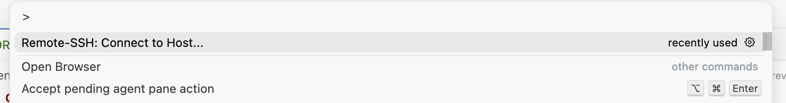
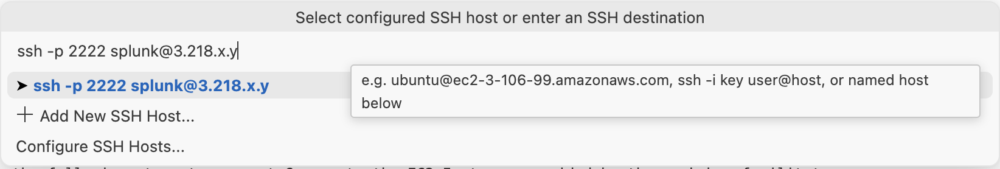

# Cursor Setup

Use the following steps to connect Cursor to the EC2 Instance provided by the workshop facilitator:

* Navigate to Extensions (`Shift+Command+X` on Mac OS)
* Search for the `Remote-SSH` extension and ensure it's installed. 

* Press `Ctrl+Shift+P` then search for the `Remote-SSH: Connect to Host...` command

* Add the SSH command from the Splunk Show event

* When prompted, enter the password from Splunk Show
* Click the `Open Folder` button in Cursor
* Open the `/home/splunk/customer-challenge` folder

Cursor asks permission before running each terminal command. Accept them as
they come. 
